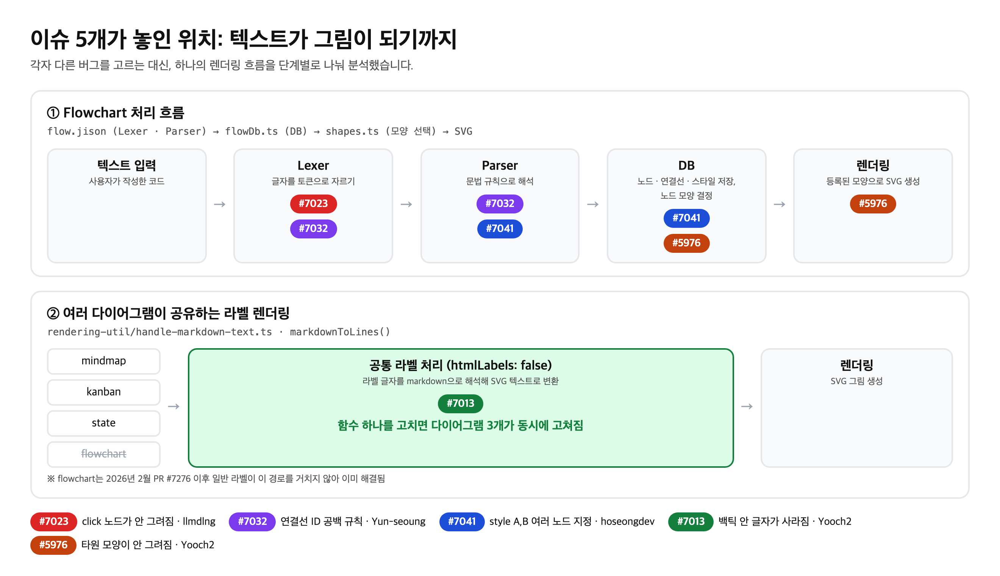

# 오픈런 (OpenRun) · Mermaid 기여 프로젝트

2026-2학기 공개소프트웨어실습 3조의 오픈소스 기여 기록입니다.

- 기여 저장소: [mermaid-js/mermaid](https://github.com/mermaid-js/mermaid)
- 주제: **작성한 대로 그려지지 않는 다이어그램 문법 버그 수정**
- 팀원: [@llmdlng](https://github.com/llmdlng) · [@Yun-seoung](https://github.com/Yun-seoung) · [@hoseongdev](https://github.com/hoseongdev) · [@Yooch2](https://github.com/Yooch2)

실제 코드 기여는 모두 mermaid 공식 저장소에 PR로 올렸고, 이 저장소에는 진행 과정과 근거 자료를 모아 두었습니다.

## 진행 현황

> 2026-10-30 기준

| 이슈 | 내용 | 담당 | PR | 상태 |
|---|---|---|---|---|
| [#7032](https://github.com/mermaid-js/mermaid/issues/7032) | 연결선 ID 앞 공백 규칙이 문법마다 다름 | @Yun-seoung | [#8459](https://github.com/mermaid-js/mermaid/pull/8459) | ✅ **머지 완료** (10/20) |
| [#7023](https://github.com/mermaid-js/mermaid/issues/7023) | `click`이라는 이름의 노드가 그려지지 않음 | @llmdlng | [#8421](https://github.com/mermaid-js/mermaid/pull/8421) | 리뷰 대기 |
| [#7041](https://github.com/mermaid-js/mermaid/issues/7041) | `style A,B`로 여러 노드에 스타일 지정이 안 됨 | @hoseongdev | [#8506](https://github.com/mermaid-js/mermaid/pull/8506) | 리뷰 대기 |
| [#7013](https://github.com/mermaid-js/mermaid/issues/7013) | `htmlLabels: false`에서 백틱(`) 안 글자가 사라짐 | @Yooch2 | [#8456](https://github.com/mermaid-js/mermaid/pull/8456) | 리뷰 대기 |
| [#5976](https://github.com/mermaid-js/mermaid/issues/5976) | flowchart 타원 문법 `A(-text-)`가 그려지지 않음 | @Yooch2 | [#8571](https://github.com/mermaid-js/mermaid/pull/8571) | 리뷰 대기 |

- 5개 이슈 모두 메인테이너가 `Status: Approved`를 붙인 이슈입니다.
- 모든 PR에 단위 테스트와 changeset(변경 기록)을 포함했습니다.
- #5976은 팀 예비 이슈로 확보해 두었다가 추가로 진행한 기여입니다.

이슈별 상세 기록: [`contributions/`](contributions/)

## 왜 Mermaid인가

Mermaid는 텍스트로 순서도, 마인드맵 같은 다이어그램을 그리는 도구입니다. GitHub과 Notion의 마크다운에 기본으로 들어가 있고, AI가 다이어그램을 만들 때도 대부분 Mermaid 코드로 출력합니다.

우리가 고른 버그들의 공통점은 **에러 없이 틀린 그림이 나오거나, 문서에 있는 문법이 그려지지 않는다**는 점입니다. 사용자가 틀린 줄 모르고 그대로 문서에 올리기 쉬운 문제라 고칠 가치가 크다고 판단했습니다.

저장소 선정 과정: [`docs/selection.md`](docs/selection.md)

## 이슈가 놓인 위치

각자 다른 버그를 고르는 대신, 텍스트가 그림이 되는 하나의 흐름을 단계별로 나눠 분석했습니다.



## 진행 과정

| 날짜 | 내용 |
|---|---|
| 10/9 | 기여 대상을 Mermaid로 결정, 이슈 배분 |
| 10/9 ~ 10/11 | 각 이슈에 작업 의사를 밝히는 댓글 작성, 최신 코드에서 직접 재현 |
| 10/11 | #8421 제출 (#7023) |
| 10/16 | #8456 제출 (#7013), 다시 검토해 2차 수정, 자동 리뷰 지적을 반영해 3차 수정 |
| 10/17 | #8459 제출 (#7032) |
| 10/19 ~ 10/20 | #8459 메인테이너 리뷰 → 반영 → 승인 → **머지** |
| 10/20 | #8506 제출 (#7041) |
| 10/27 | #8571 제출 (#5976), 로컬에서 e2e까지 검증 후 제출 |

날짜는 모두 한국 시간 기준입니다.

## 진행하며 배운 점

- **이슈를 그대로 믿지 않고 최신 코드에서 먼저 재현했습니다.** 처음 고른 #7042는 이미 고쳐져 있어 #7041로 바꿨고, #7013은 이슈에 있던 flowchart 예시가 이미 다른 PR로 해결돼 있어서 범위를 다시 정리했습니다.
- **기존 코드와 테스트에서 설계 의도를 확인했습니다.** #5976에서는 처음 방식이 메인테이너가 일부러 넣은 테스트와 부딪히는 것을 발견하고, 그 결정을 지키는 방식으로 바꿨습니다.
- **자동 리뷰 지적도 직접 검증한 뒤 반영했습니다.** 지적 내용을 실제로 렌더링해서 확인하고, 맞는 경우에만 고쳤습니다.
- **외부 기여자 PR이 처리되는 흐름을 직접 겪었습니다.** 메인테이너가 리뷰를 몰아서 하고, 포크에서 올린 PR은 e2e 테스트용 라벨이 자동으로 붙지 않는 문제도 있었습니다(이후 메인테이너가 수정).

## 폴더 구성

```
contributions/
  7013/  백틱 안 글자 사라짐 (수정 과정 이미지 포함)
  5976/  타원 모양 (수정 전후, e2e, 설계 근거 포함)
  7023/  click 노드
  7032/  연결선 ID 공백 (머지까지의 리뷰 과정)
  7041/  style 여러 노드
docs/
  pipeline.png   이슈 위치 그림
  selection.md   저장소 선정 과정
```
