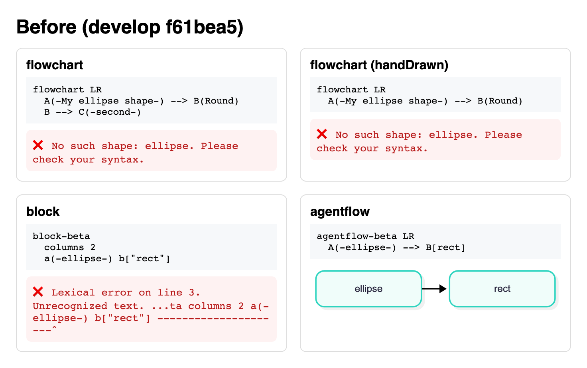
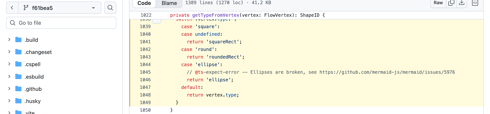
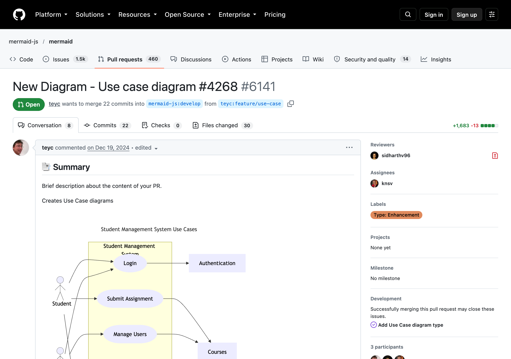
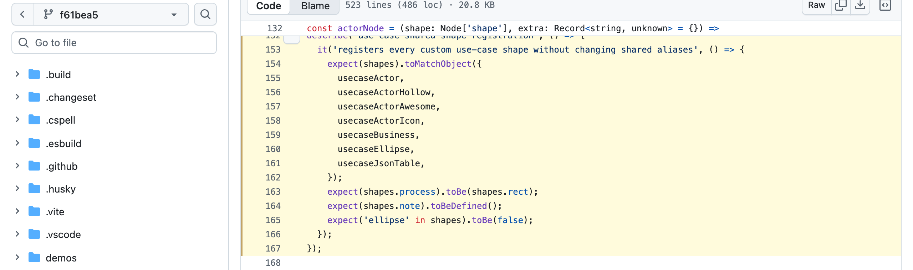
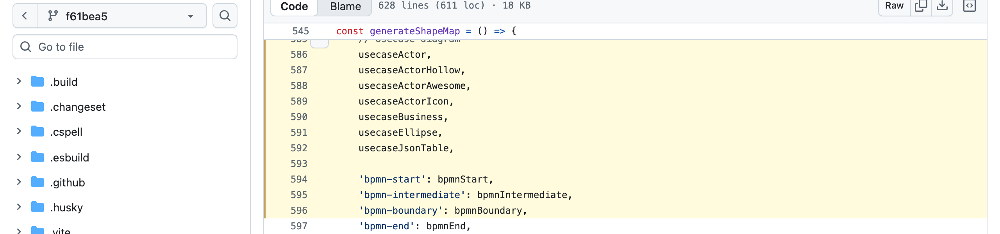
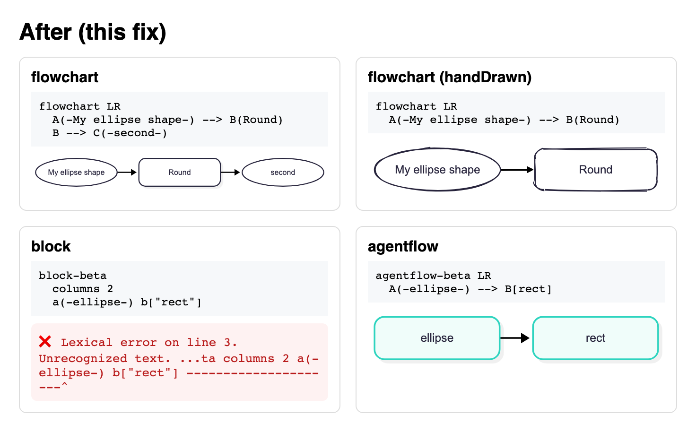
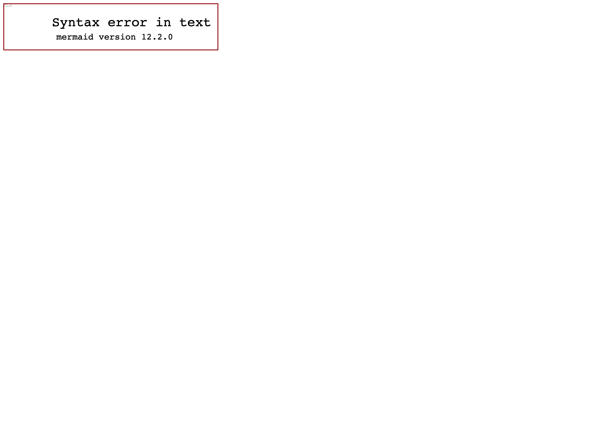
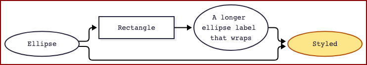
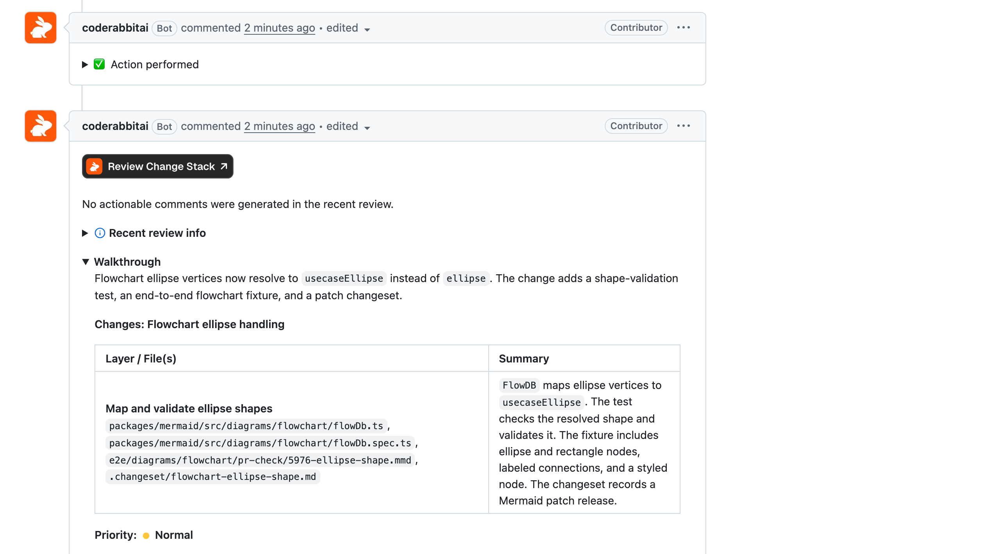
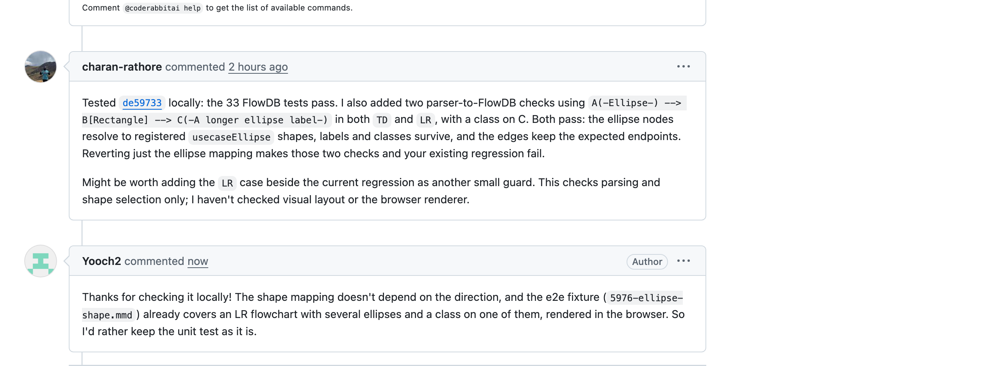

# #5976 flowchart 타원 모양 `A(-text-)`이 그려지지 않는 버그

- 이슈: https://github.com/mermaid-js/mermaid/issues/5976
- PR: https://github.com/mermaid-js/mermaid/pull/8571
- 작업 브랜치: https://github.com/Yooch2/mermaid/tree/bug/5976_flowchart-ellipse-shape
- 담당: [@Yooch2](https://github.com/Yooch2)
- 상태: 메인테이너 리뷰 대기 (10/27 제출)

메인 이슈 [#7013](../7013/)(PR #8456)이 머지되지 않을 경우에 대비해 **추가로 진행한 기여**입니다. 팀 예비 이슈로 확보해 두었다가, #7013 PR을 마친 뒤 작업했습니다.

## 문제

flowchart의 타원 문법을 쓰면 그림이 그려지지 않고 에러가 납니다.

```
flowchart LR
  A(-My ellipse shape-) --> B(Round)
```

→ `Error: No such shape: ellipse. Please check your syntax.`

예전 렌더러(mermaid 9.1.7까지)에서는 잘 그려지던 문법입니다.



## 원인

1. 파서는 정상입니다. `A`를 `type: 'ellipse'` 노드로 제대로 읽습니다.
2. `flowDb.ts`의 `getTypeFromVertex()`가 이 노드에 `'ellipse'`라는 모양 이름을 붙입니다.
3. 그런데 새 렌더러의 모양 목록(`shapes.ts`)에는 `ellipse`라는 이름이 없어서 렌더링 단계에서 에러가 납니다.

코드에도 메인테이너가 남긴 "타원이 깨져 있다, #5976 참고" 주석이 있었습니다.



## 작업 전 확인

- 이 이슈를 가져간 사람이나 고친 PR이 없는지 확인했습니다.
- 이슈 댓글에 언급된 #6141에도 타원 모양 코드가 있었지만, 2025년 초 이후 멈춘 PR이었고 본래 목적이던 유스케이스 다이어그램은 다른 PR(#8048)로 이미 들어가 있었습니다.



## 설계 결정

### 처음 방식: 모양 목록에 `ellipse` 등록 → 바꿈

처음에는 공통 모양 목록에 `ellipse`를 추가했습니다. 그런데 전체 단위 테스트를 돌려 보니 메인테이너가 넣어 둔 테스트가 실패했습니다.



커밋 기록을 찾아보니 메인테이너가 유스케이스 다이어그램 작업 중 공개 모양 `ellipse`를 넣었다가 리뷰를 거쳐 일부러 뺐고, 이 테스트로 막아 둔 것이었습니다. 이 결정을 거스르면 리뷰에서 받아들여지기 어렵다고 보고 방식을 바꿨습니다.

### 바꾼 방식: 이미 있는 `usecaseEllipse` 사용

공통 목록은 건드리지 않고, flowchart가 이미 등록된 타원 모양 `usecaseEllipse`를 쓰도록 매핑만 바꿨습니다.



- 손그림 모양, 연결선이 타원 테두리에 붙는 계산이 이미 구현돼 있습니다.
- flowchart 스타일에 이미 `.node ellipse` 규칙이 있어서 테마 색, `style`, `classDef`가 그대로 적용됩니다.

### 최종 코드 (2줄)

```ts
case 'ellipse':
  // There is no shared `ellipse` shape, so `A(-text-)` reuses the use case oval
  return 'usecaseEllipse';
```



block 다이어그램은 문법 단계에서 막히는 별개 문제이고, agentflow는 타원을 일부러 사각형으로 바꾸도록 설계돼 있어서 둘 다 건드리지 않았습니다.

## 테스트

- **단위 테스트**: 타원 노드가 실제로 그릴 수 있는 모양으로 연결되는지 확인
- **e2e 테스트**: 타원 노드 3개(긴 라벨, 스타일 포함)를 실제 브라우저로 그려서 확인 (`5976-ellipse-shape.mmd`)

| 수정 전 (e2e 실패) | 수정 후 (e2e 통과) |
|---|---|
|  |  |

## 검증

| 항목 | 결과 |
|---|---|
| 새 단위 테스트 | 수정 전 실패 → 수정 후 통과 |
| 전체 단위 테스트 | 6,879개 통과 |
| 타입 검사 | 에러 0 |
| eslint, prettier, 맞춤법 | 통과 |
| 로컬 e2e | flowchart 17개 모두 통과 |
| 렌더링 | 손그림, 스타일, classDef, 긴 라벨, ELK 레이아웃, 다크 테마 등 15가지 경우 정상 |
| CI | e2e 포함 22개 통과 |
| CodeRabbit | 지적 없음, 사전 점검 5개 모두 통과 |
| codecov | 수정한 줄 100% 테스트 |



## PR 이후 소통

- 화면 비교 도구(argos)에서 gantt 화면 1개가 "변경"으로 나왔는데, 다른 최근 PR들에도 똑같이 나오는 무관한 변경이어서 메인테이너가 헷갈리지 않도록 설명 댓글을 남겼습니다.
- 다른 기여자가 우리 커밋을 직접 받아 테스트하고 "LR 방향 테스트도 추가하면 좋겠다"고 제안했습니다. 모양 결정은 방향과 관계없고 e2e가 LR 방향까지 이미 확인하고 있어서, 이유를 설명하고 지금 테스트를 유지했습니다.



## 파일

| 파일 | 내용 |
|---|---|
| `change.diff` | 실제 수정 내용 |
| `render-screenshot.mjs` | 수정 전후 렌더링 캡처 스크립트 |
| `github-issue-full.png`, `github-claim-comment.png` | 이슈와 작업 의사 댓글 |
| `github-pr.png`, `github-pr-bots.png`, `github-pr-checks.png` | PR 화면과 CI 결과 |
| `argos-build.png`, `github-argos-note.png` | 화면 비교 결과와 설명 댓글 |
