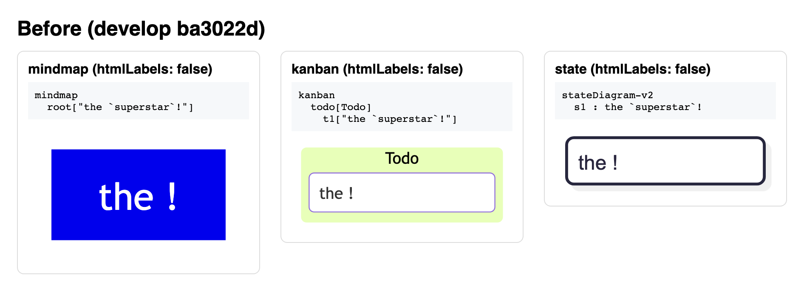
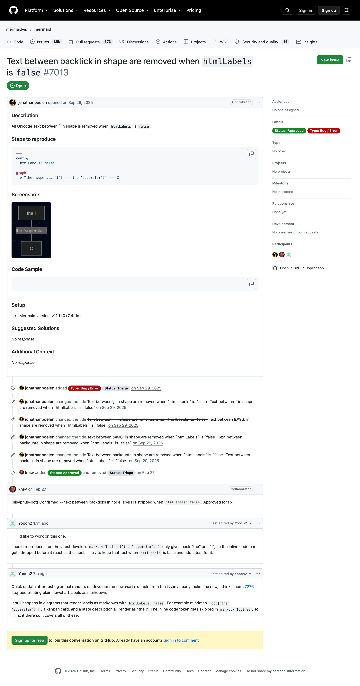
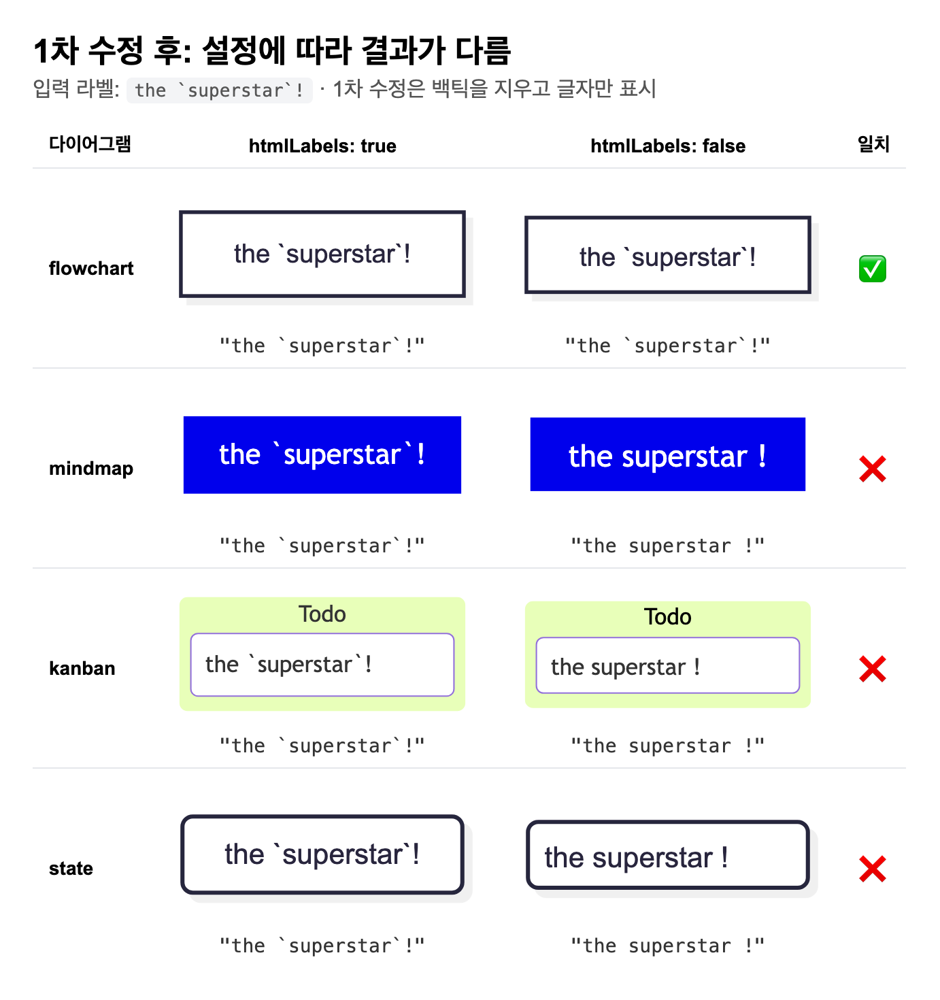
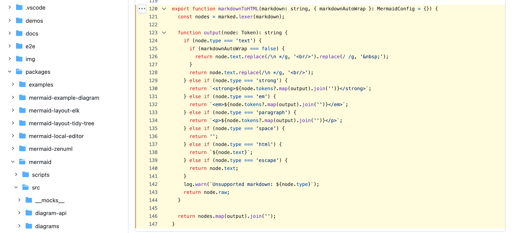
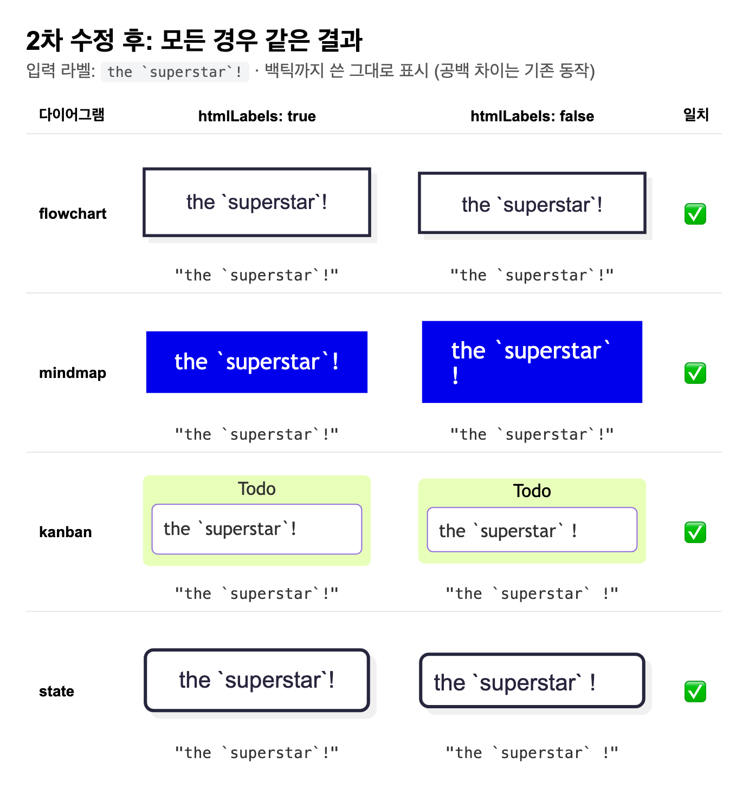
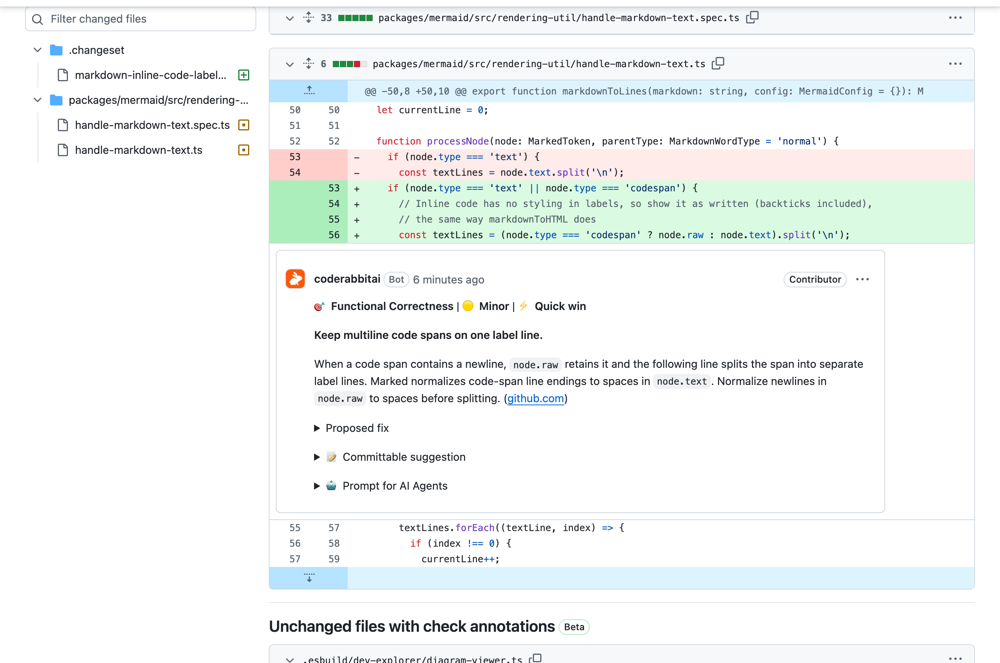
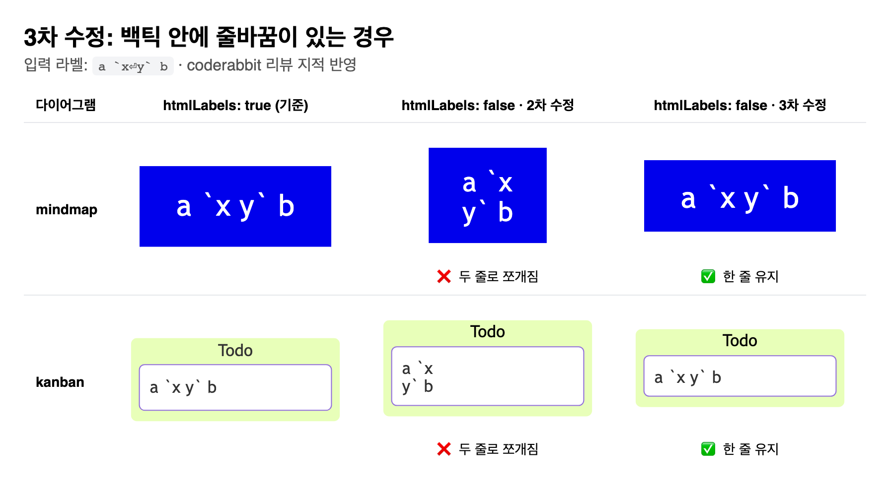
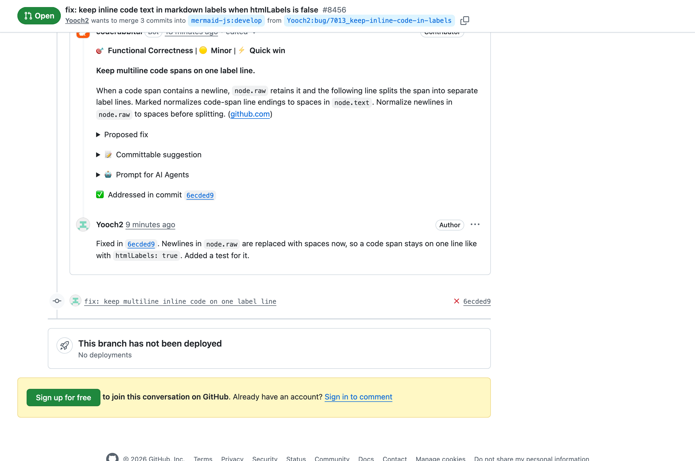
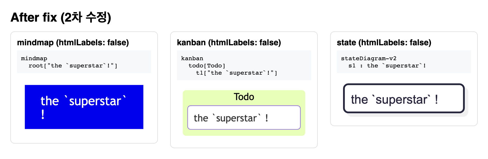
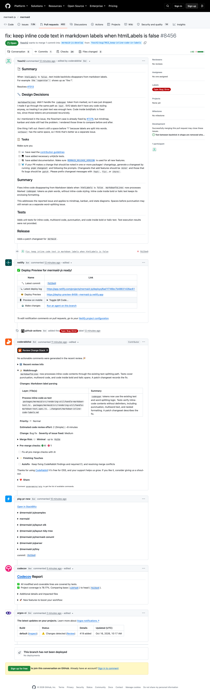

# #7013 백틱(`) 안의 글자가 사라지는 버그

- 이슈: https://github.com/mermaid-js/mermaid/issues/7013
- PR: https://github.com/mermaid-js/mermaid/pull/8456
- 담당: [@Yooch2](https://github.com/Yooch2)
- 상태: 메인테이너 리뷰 대기 (10/16 제출, 커밋 3개)

## 문제

`htmlLabels: false` 설정에서 라벨에 백틱으로 감싼 글자를 쓰면 그 부분이 에러 없이 통째로 사라집니다.

- 입력 ``the `superstar`!`` → 출력 **"the !"**
- ``Run `npm install` first``라고 쓰면 **"Run first"**로 그려져 다이어그램이 틀린 설명을 전달합니다.
- mindmap, kanban, state 세 다이어그램에서 발생합니다.



이슈에 있던 flowchart 예시는 2026년 2월 PR #7276 이후 이미 해결돼 있었습니다. 최신 코드에서 직접 재현해 보고 범위를 다시 정리해 이슈에 공유했습니다.



## 원인

라벨을 단어 단위로 나누는 공통 함수 `markdownToLines()`(`rendering-util/handle-markdown-text.ts`)가 문제였습니다.

1. 라벨을 markdown 해석기(`marked`)로 토큰 단위로 자릅니다.
2. 백틱 부분은 `codespan` 토큰이 됩니다.
3. 그런데 함수가 `text`, `strong`, `em`, `html`만 처리하고 `codespan`은 그냥 버렸습니다.

공통 함수라서 이 한 곳을 고치면 세 다이어그램이 같이 고쳐집니다.

## 수정 과정 (커밋 3개)

### 1차 수정: 글자 살리기
`codespan`도 일반 텍스트처럼 처리해서 사라진 글자를 살렸습니다. 결과는 "the superstar !"였습니다.

### 스스로 다시 검토하다 발견한 문제
같은 라벨을 다이어그램과 설정별로 전부 렌더링해 보니, 1차 수정만 백틱을 지우고 다른 경우는 모두 백틱을 그대로 보여 주고 있었습니다.



HTML 라벨을 만드는 함수 `markdownToHTML()`은 모르는 토큰을 `return node.raw`로 쓴 그대로 내보냅니다.



### 2차 수정: 쓴 그대로 보여 주기
`codespan`일 때 원문(`node.raw`, 백틱 포함)을 쓰도록 바꿔서 모든 경우의 결과를 맞췄습니다.



### 3차 수정: 자동 리뷰 지적 반영
자동 리뷰 봇(CodeRabbit)이 "백틱 안에 줄바꿈이 있으면 라벨이 두 줄로 쪼개진다"고 지적했습니다. 직접 렌더링해서 사실인지 확인한 뒤, 줄바꿈을 공백으로 바꾸도록 고쳤습니다.




푸시 전에 라벨 7종 × 다이어그램 3종 × 설정 2개, 총 20가지 경우를 렌더링해서 글자가 다른 경우가 없는 것을 확인했습니다. 답글을 단 뒤 리뷰 스레드가 해결 처리됐습니다.



### 최종 코드

```ts
if (node.type === 'text' || node.type === 'codespan') {
  // Inline code has no styling in labels, so show it as written (backticks included),
  // the same way markdownToHTML does. A code span stays on one line, like in HTML.
  const content = node.type === 'codespan' ? node.raw.replace(/\n/g, ' ') : node.text;
  const textLines = content.split('\n');
```



## 검증

| 항목 | 결과 |
|---|---|
| 새 단위 테스트 | 수정 전 실패 → 수정 후 통과 |
| 전체 단위 테스트 | 6,747개 통과 |
| eslint, prettier | 통과 |
| CodeRabbit | 지적 1건 반영, 이후 지적 없음 |
| codecov | 수정한 줄 100% 테스트 |

`e2e-required` 체크는 첫 커밋에서 통과했지만, 이후 커밋에서는 외부 PR에 `run pr tests` 라벨이 자동으로 붙지 않아 건너뛰어졌습니다(이후 메인테이너가 자동 라벨 문제를 수정했습니다).



## 범위 밖

- 라벨을 단어 단위로 나눠 그리는 구조 때문에 `superstar`와 `!` 사이에 공백이 생깁니다. 굵게(`**the**!`)에서도 같은 기존 동작이라 따로 다룰 문제로 남겼습니다.
- `escape`, 링크 같은 다른 토큰도 `markdownToLines`에서 처리되지 않는데, 이 이슈와는 별개입니다.
