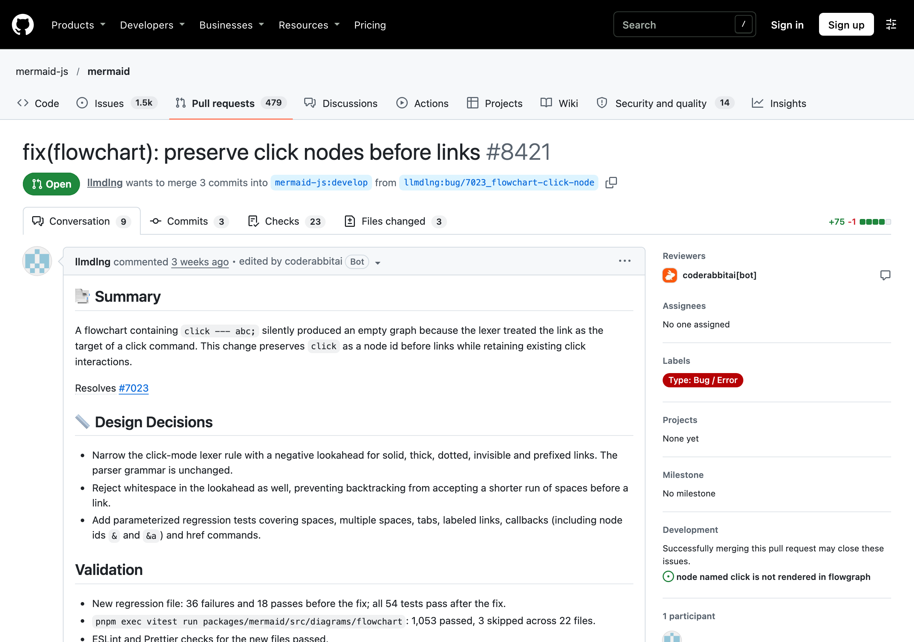

# #7023 `click`이라는 이름의 노드가 그려지지 않는 버그

- 이슈: https://github.com/mermaid-js/mermaid/issues/7023
- PR: https://github.com/mermaid-js/mermaid/pull/8421
- 담당: [@llmdlng](https://github.com/llmdlng)
- 상태: 메인테이너 리뷰 대기 (10/11 제출)

## 문제

노드 이름을 `click`으로 짓고 뒤에 연결선을 쓰면, 에러 없이 빈 그림이 나옵니다.

```
flowchart LR
  click --- abc
```

## 원인

Lexer가 `click` 뒤에 공백만 오면 무조건 "클릭 명령(click 노드에 링크 걸기)"으로 해석했습니다. 그래서 뒤에 오는 연결선 `---`가 클릭 대상 이름으로 먹혀 버려 노드와 연결선이 모두 사라졌습니다. `click--- up`처럼 공백이 없으면 정상이었습니다.

## 수정

- click 명령으로 들어가는 lexer 규칙에, **뒤에 연결선 기호가 오면 클릭 명령으로 보지 않는** 조건(lookahead)을 추가했습니다. 문법 규칙은 바꾸지 않았습니다.
- 공백, 여러 칸 공백, 탭, 라벨 있는 연결선, 콜백, href 명령까지 확인하는 회귀 테스트를 추가했습니다(수정 전 36개 실패 → 수정 후 54개 통과).

## 설계 근거

이슈에서는 "에러를 낸다"와 "`click`을 노드 이름으로 허용한다" 두 의견이 있었습니다. PR은 허용하는 방향으로 고쳤고, 팀에서 기존 테스트(`flow-singlenode.spec.js`)를 확인해 보니 `click`이 노드 이름에 쓸 수 있는 키워드 목록(`workingKeywords`)에 들어 있어 이 방향이 원래 설계와 맞는 것을 확인했습니다.

## PR 이후

- 자동 리뷰 봇(CodeRabbit)이 `&a`처럼 `&`로 시작하는 노드에 click 명령을 걸 때의 예외 케이스를 지적했고, 수정 후 해결 처리됐습니다.
- `e2e-required` 체크는 외부 PR에 `run pr tests` 라벨이 자동으로 붙지 않아 건너뛰어진 상태입니다. 메인테이너가 라벨을 붙이면 다시 실행됩니다.


