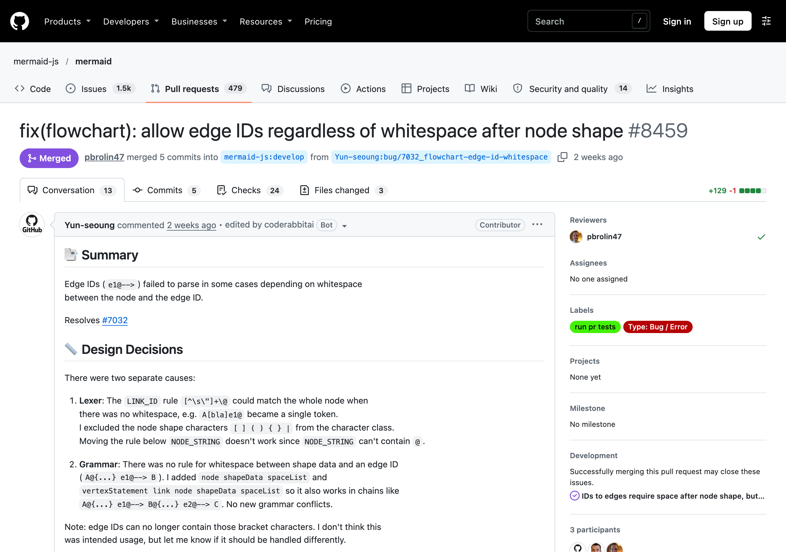
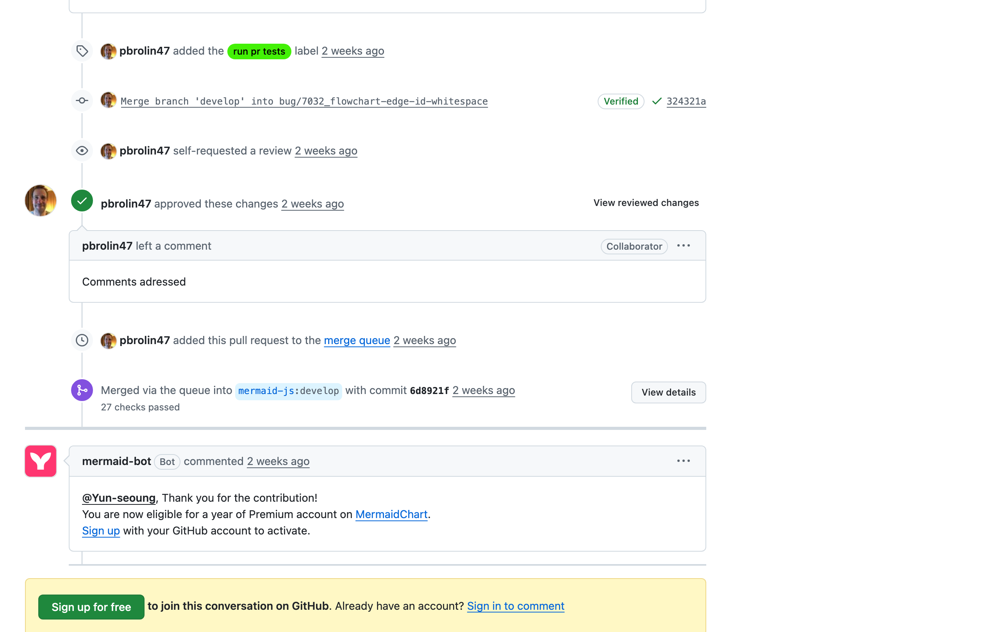

# #7032 연결선 ID 앞 공백 규칙이 문법마다 다른 버그

- 이슈: https://github.com/mermaid-js/mermaid/issues/7032
- PR: https://github.com/mermaid-js/mermaid/pull/8459
- 작업 브랜치: https://github.com/Yun-seoung/mermaid/tree/bug/7032_flowchart-edge-id-whitespace
- 담당: [@Yun-seoung](https://github.com/Yun-seoung)
- 상태: ✅ **머지 완료** (10/17 제출 → 10/20 머지)

## 문제

연결선에 ID를 붙이는 문법(`e1@-->`)이 노드와 ID 사이 공백 유무에 따라 파싱에 실패했습니다.

```
A[bla]e1@--> B                  %% 공백 없음: 실패
A@{shape: circle} e1@--> B      %% 새 모양 문법 뒤 공백: 실패
```

## 원인

원인이 두 가지였습니다.

1. **Lexer**: 연결선 ID 규칙 `[^\s\"]+\@`가 공백이 없으면 노드까지 한꺼번에 먹어서, `A[bla]e1@`가 토큰 하나가 됐습니다.
2. **Parser**: 새 모양 문법(`@{...}`)과 연결선 ID 사이에 공백이 오는 경우의 문법 규칙이 없었습니다.

## 수정

1. 연결선 ID 규칙에서 노드 모양 문자 `[ ] ( ) { } |`를 제외했습니다.
2. 문법 규칙 2개(`node shapeData spaceList`, `vertexStatement link node shapeData spaceList`)를 추가해 `A@{...} e1@--> B@{...} e2@--> C` 같은 연결도 동작하게 했습니다. 새 문법 충돌은 없습니다.

이제 연결선 ID에는 괄호 문자를 쓸 수 없는데, 원래 의도된 사용법은 아니라고 판단해 PR에 함께 적었습니다.

## 리뷰와 머지



| 시간 (한국) | 내용 |
|---|---|
| 10/19 21:24 | 메인테이너 pbrolin47 리뷰: "Some things to address" |
| 10/19 21:37 | 테스트를 보강한 커밋으로 대응 |
| 10/19 21:52 | 메인테이너가 `run pr tests` 라벨 추가 (e2e 실행) |
| 10/20 00:05 | 승인: "Comments adressed" |
| 10/20 00:18 | **merge queue를 거쳐 develop에 머지** (체크 27개 통과) |



팀에서 처음으로 머지된 기여입니다. 리뷰를 받고 13분 만에 대응한 것이 빠른 머지로 이어졌습니다.
