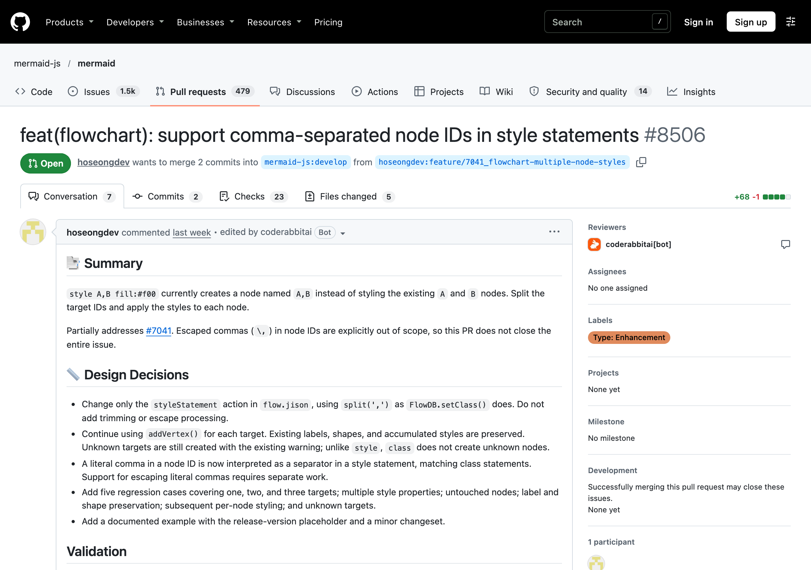

# #7041 `style A,B`로 여러 노드에 스타일을 지정할 수 없는 문제

- 이슈: https://github.com/mermaid-js/mermaid/issues/7041
- PR: https://github.com/mermaid-js/mermaid/pull/8506
- 작업 브랜치: https://github.com/hoseongdev/mermaid/tree/feature/7041_flowchart-multiple-node-styles
- 담당: [@hoseongdev](https://github.com/hoseongdev)
- 상태: 메인테이너 리뷰 대기 (10/20 제출)

## 문제

`class`는 `class A,B red`처럼 쉼표로 여러 노드를 한 번에 지정할 수 있는데, `style`은 안 됐습니다.

```
flowchart LR
  A --> B
  style A,B fill:#f00
```

A와 B에 스타일이 적용되지 않고, 이름이 `A,B`인 노드가 새로 생겼습니다.

## 원인

`flow.jison`의 `styleStatement` 규칙이 노드 이름을 쉼표로 나누지 않고 통째로 `addVertex()`에 넘겼습니다.

## 수정

- `class`를 처리하는 `setClass()`와 같은 방식으로, 대상 이름을 쉼표로 나눠 각 노드에 스타일을 적용했습니다. 바꾼 곳은 `styleStatement` 규칙 하나입니다.
- 노드 1개·2개·3개, 여러 스타일 속성, 다른 노드는 그대로인지, 라벨과 모양 유지, 없는 노드 지정 등 회귀 테스트 5개를 추가했습니다(수정 전 4개 실패 → 수정 후 통과).
- 문서(`flowchart.md`)에 예시를 추가하고, 새 기능이라 minor changeset을 넣었습니다.

## 범위

노드 이름 안에 쉼표를 쓰기 위한 이스케이프(`\,`)는 따로 작업이 필요해서, PR에 "이슈 일부 해결(Partially addresses)"로 명시했습니다.

## PR 이후

- 자동 리뷰 봇(CodeRabbit)이 쉼표 뒤에 공백이 있는 경우(`style A, B ...`)를 지적해 검토 중입니다. 참고로 기존 `class` 문법도 `class A, B`는 지원하지 않습니다.
- `e2e-required` 체크는 외부 PR에 `run pr tests` 라벨이 자동으로 붙지 않아 건너뛰어진 상태입니다.


